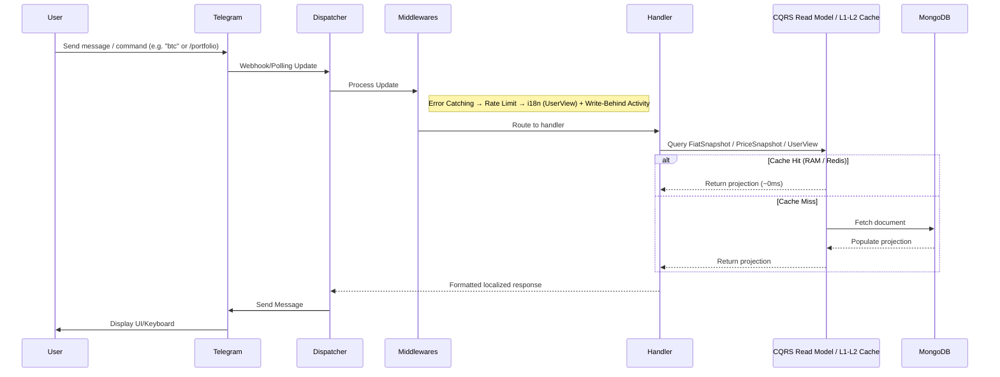
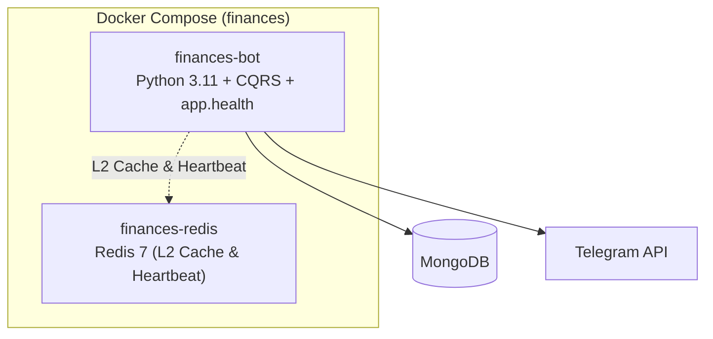

[← Back to docs index](README.md)

# 🏗 Architecture

**TL;DR:** Finances is an asynchronous Telegram bot built with Python (`aiogram` 3.x) and MongoDB (`motor`), powered by an internal **CQRS (Command Query Responsibility Segregation)** layer and a **two-tier L1 (in-memory) + L2 (Redis) cache**. It features a multi-layered middleware architecture, resilient background data scraping using `curl_cffi`, supervised background workers (`TaskSupervisor`) for alerts, volatility monitoring, weekly digests, and streaming backups, plus a container healthcheck (`app.health`).

## System Overview

### 1. Telegram Bot Core (`app/`)
- **Bot & Dispatcher (`bot.py`)**: Initializes the aiogram `Bot` and `Dispatcher`, injecting global middlewares (Error, I18n, RateLimit, GroupCooldown) and registering all command routers.
- **CQRS & Event-Driven Layer (`cqrs/`)**:
  - **Database Interceptor (`cqrs/interceptor.py`)**: Wraps `AsyncIOMotorDatabase` (`InterceptedDatabase`) to transparently serve hot reads (`fiat_rates`) from RAM and emit domain events (`UserConfigChangedEvent`, `PortfolioChangedEvent`, `RatesUpdatedEvent`) on writes.
  - **Read Projections (`cqrs/read/`)**: In-memory read models for fiat exchange rates (`FiatSnapshot`), crypto/stock prices (`PriceSnapshot`), and user preferences (`UserView`).
  - **Write-Behind Buffer (`cqrs/write/activity.py`)**: Buffers per-request user activity (`last_active`, `total_requests`) and flushes in batched `bulk_write` operations every 15 seconds.
  - **Task Supervisor (`cqrs/tasks.py`)**: Supervises background workers with automatic crash recovery and exponential backoff.
- **Routers (`handlers/`)**: Contain the logic for responding to Telegram updates (`start`, `exchange`, `crypto`, `stocks`, `portfolio`, `alerts`, `settings`, `admin`, `groups`, `inline_query`).
- **Services (`services/`)**: Background loops and domain logic (parsers, alerts, volatility monitor, weekly digest scheduler, streaming backups, Fernet encryption).
- **Two-Tier Cache (`cache.py` + `redis_client.py`)**: `TwoTierCache` combines an ultra-fast L1 in-memory `MemoryCache` with an optional L2 Redis backend (`settings.redis.url`), providing automatic fallback when Redis is unavailable.
- **Healthcheck (`health.py`)**: Executed via `python -m app.health` by Docker `HEALTHCHECK` to verify the event-loop Redis heartbeat, MongoDB connectivity, and supervised background tasks.

## Data Flow Diagram

## Parsing Engine (`curl_cffi`)

The bot requires live currency and asset rates. Instead of standard `aiohttp` or `requests`, the fiat parser utilizes **`curl_cffi`**:
- **Why `curl_cffi`?** It impersonates a real browser's TLS/JA3 fingerprints to reliably fetch rates from sources behind anti-bot protection (`fx-rate.net`), protected by a `CircuitBreaker` and `@retry_transient`.
- **Flow**: The parser runs as a supervised background worker (`run_parser_loop()`), fetching data at intervals defined in `settings.parser.update_interval_sec` and publishing `RatesUpdatedEvent` to refresh in-memory CQRS snapshots.

## Supervised Background Workers

The entry point (`__main__.py`) spawns all long-running loops via `TaskSupervisor` (`app/cqrs/tasks.py`) before starting aiogram polling:

| Task Name | Function | Interval | Description |
|-----------|----------|----------|-------------|
| **parser** | `run_parser_loop()` | `parser.update_interval_sec` | Scrapes fresh fiat/crypto/stock rates, updates MongoDB & CQRS snapshots. |
| **alerts** | `run_alert_checker()` | 60 seconds | Checks untriggered user price targets (`Alerts` collection) against live rates. |
| **volatility** | `run_volatility_monitor()` | 300 seconds | Compares live prices against 1h snapshots (`price_history`) for user holdings (`>= 1%`). |
| **digest** | `run_digest_scheduler()` | 30 min eval / Sunday 10:00 UTC | Builds and sends weekly portfolio performance digests (crypto, stocks, fiat). |
| **analytics** | `AnalyticsReporter.start()` | Scheduled | Background aggregation and group delivery of analytics reports. |
| **backup** | `run_daily_backup_loop()` | Daily at 03:00 UTC | Low-memory streaming `.json.gz` MongoDB backup with 7-day rotation. |
| **activity_flusher** | `activity_buffer.run_flusher()` | 15 seconds | Flushes buffered user activity and `DailyStats` increments via `bulk_write`. |
| **cache_cleanup** | `_cache_cleanup_loop()` | 300 seconds | Evicts expired entries from the L1 in-memory cache. |
| **heartbeat** | `_heartbeat_loop()` | 15 seconds | Writes `health:heartbeat` to Redis for Docker healthchecks. |

## Configuration Architecture

Settings are loaded from `config/settings.json` into frozen Python dataclasses via `get_settings()`, with automatic hot-reload when the file's modification time changes:

| Dataclass | Key Fields |
|---|---|
| `BotSettings` | `token`, `admin_ids`, `backup_enabled`, `version` |
| `DatabaseSettings` | `mongo_uri`, `mongo_database`, `pool_min`, `pool_max` |
| `ParserSettings` | `auto_update`, `update_interval_sec`, `critical_currencies`, `retry_attempts` |
| `SecuritySettings` | `rate_limit_requests`, `rate_limit_window_sec`, `fernet_key` |
| `FeaturesSettings` | `mini_app_enabled`, `groups_enabled`, `inline_mode_enabled` |
| `DraftSettings` | `enabled`, `loading_threshold_sec`, `animation_interval_sec` |
| `RedisSettings` | `url`, `max_connections`, `socket_timeout` |
| `I18nSettings` | `supported_languages`, `default_language` |

## Docker Architecture

---

*Last updated: 2026-11-09*
