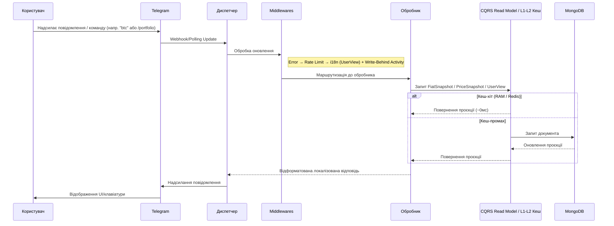
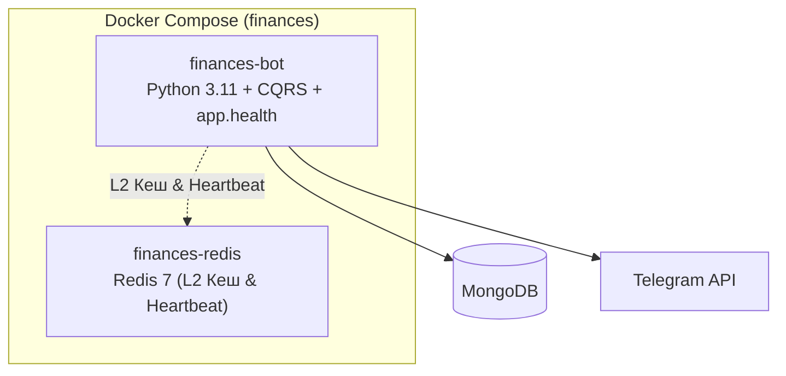

[← Повернутися до змісту](README.md)

# 🏗 Архітектура

**Коротко:** Finances — це асинхронний Telegram-бот, побудований на Python (`aiogram` 3.x) та MongoDB (`motor`), із внутрішнім **CQRS-шаром** та **дворівневим кешем L1 (in-memory) + L2 (Redis)**. Має багаторівневу архітектуру middleware, фоновий парсинг даних через `curl_cffi`, контрольовані фонові воркери (`TaskSupervisor`) для алертів, моніторингу волатильності, щотижневих дайджестів і потокових бекапів, а також модуль перевірки стану контейнера (`app.health`).

## Огляд системи

### 1. Ядро Telegram-бота (`app/`)
- **Бот і Диспетчер (`bot.py`)**: Ініціалізує aiogram `Bot` та `Dispatcher`, впроваджуючи глобальні middleware (Error, I18n, RateLimit, GroupCooldown) та реєструючи всі роутери команд.
- **CQRS та подієво-орієнтований шар (`cqrs/`)**:
  - **Перехоплювач БД (`cqrs/interceptor.py`)**: Обгортає `AsyncIOMotorDatabase` (`InterceptedDatabase`), прозоро віддаючи часті запити (`fiat_rates`) з оперативної пам'яті та публікуючи доменні події (`UserConfigChangedEvent`, `PortfolioChangedEvent`, `RatesUpdatedEvent`) при записах.
  - **Read-моделі (`cqrs/read/`)**: In-memory проєкції для курсів фіатних валют (`FiatSnapshot`), цін крипти й акцій (`PriceSnapshot`) та налаштувань користувачів (`UserView`).
  - **Write-Behind буфер (`cqrs/write/activity.py`)**: Буферизує активність користувачів (`last_active`, `total_requests`) у пам'яті та скидає в MongoDB пакетним `bulk_write` кожні 15 секунд.
  - **Супервізор задач (`cqrs/tasks.py`)**: Контролює фонові таски з автоматичним перезапуском та експоненційним backoff у разі збоїв.
- **Роутери (`handlers/`)**: Містять логіку обробки оновлень Telegram (`start`, `exchange`, `crypto`, `stocks`, `portfolio`, `alerts`, `settings`, `admin`, `groups`, `inline_query`).
- **Сервіси (`services/`)**: Фонові цикли та бізнес-логіка (парсери, алерти, моніторинг волатильності, планувальник дайджестів, потокові бекапи, шифрування Fernet).
- **Дворівневий кеш (`cache.py` + `redis_client.py`)**: `TwoTierCache` поєднує швидкий L1 in-memory `MemoryCache` з опціональним L2 Redis (`settings.redis.url`), забезпечуючи прозорий fallback при недоступності Redis.
- **Healthcheck (`health.py`)**: Викликається через `python -m app.health` у Docker `HEALTHCHECK` для перевірки heartbeat-пульсу в Redis, пінгу MongoDB та стану фонових воркерів.

## Діаграма потоку даних

## Парсер (`curl_cffi`)

Бот потребує актуальних курсів валют і цін активів. Замість стандартних `aiohttp` чи `requests`, фіатний парсер використовує **`curl_cffi`**:
- **Чому `curl_cffi`?** Він імітує TLS/JA3-відбитки справжнього браузера для обходу антибот-захисту (`fx-rate.net`) та захищений `CircuitBreaker` і `@retry_transient`.
- **Потік**: Парсер працює як контрольований фоновий воркер (`run_parser_loop()`), отримуючи дані з інтервалами `settings.parser.update_interval_sec` та публікуючи `RatesUpdatedEvent` для миттєвого оновлення CQRS-снепшотів у пам'яті.

## Контрольовані фонові воркери

Точка входу (`__main__.py`) запускає всі фонові цикли через `TaskSupervisor` (`app/cqrs/tasks.py`) перед стартом aiogram polling:

| Назва задачі | Функція | Інтервал | Опис |
|-----------|----------|----------|-------------|
| **parser** | `run_parser_loop()` | `parser.update_interval_sec` | Збирає свіжі курси фіат/крипто/акцій, оновлює MongoDB та CQRS-снепшоти. |
| **alerts** | `run_alert_checker()` | 60 секунд | Перевіряє досягнення цінових цілей користувачів (колекція `Alerts`). |
| **volatility** | `run_volatility_monitor()` | 300 секунд | Порівнює поточні ціни з годинними снепшотами (`price_history`) для активів у портфелях (`>= 1%`). |
| **digest** | `run_digest_scheduler()` | 30 хв / Неділя 10:00 UTC | Формує та розсилає щотижневі звіти портфелів (крипта, акції, фіат). |
| **analytics** | `AnalyticsReporter.start()` | За розкладом | Фонова агрегація та надсилання аналітичних звітів у групи. |
| **backup** | `run_daily_backup_loop()` | Щодня о 03:00 UTC | Потоковий `.json.gz` бекап MongoDB з низьким споживанням пам'яті та ротацією 7 архівів. |
| **activity_flusher** | `activity_buffer.run_flusher()` | 15 секунд | Пакетно записує буферизовану активність користувачів і `DailyStats` через `bulk_write`. |
| **cache_cleanup** | `_cache_cleanup_loop()` | 300 секунд | Очищує прострочені записи з L1 in-memory кешу. |
| **heartbeat** | `_heartbeat_loop()` | 15 секунд | Оновлює `health:heartbeat` у Redis для Docker healthcheck. |

## Архітектура конфігурації

Налаштування завантажуються з `config/settings.json` у frozen Python dataclass-и через `get_settings()` з автоматичним перезавантаженням при зміні часу модифікації файлу:

| Dataclass | Ключові поля |
|---|---|
| `BotSettings` | `token`, `admin_ids`, `backup_enabled`, `version` |
| `DatabaseSettings` | `mongo_uri`, `mongo_database`, `pool_min`, `pool_max` |
| `ParserSettings` | `auto_update`, `update_interval_sec`, `critical_currencies`, `retry_attempts` |
| `SecuritySettings` | `rate_limit_requests`, `rate_limit_window_sec`, `fernet_key` |
| `FeaturesSettings` | `mini_app_enabled`, `groups_enabled`, `inline_mode_enabled` |
| `DraftSettings` | `enabled`, `loading_threshold_sec`, `animation_interval_sec` |
| `RedisSettings` | `url`, `max_connections`, `socket_timeout` |
| `I18nSettings` | `supported_languages`, `default_language` |

## Docker-архітектура

---

*Останнє оновлення: 2026-11-09*
